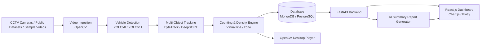

<div align="center">

# 🚦 IntelliTraffic AI

### AI-Powered Urban Traffic Monitoring and Predictive Analytics System

*Real-time vehicle detection, tracking, counting and congestion analytics from CCTV video, served through a FastAPI backend to an interactive React dashboard.*


</div>

---

## 📑 Table of Contents

1. [Overview](#-overview)
2. [Problem Statement & Motivation](#-problem-statement--motivation)
3. [Key Features](#-key-features)
4. [System Architecture](#-system-architecture)
5. [How It Works (Processing Pipeline)](#-how-it-works-processing-pipeline)
6. [Tech Stack](#-tech-stack)
7. [Repository Structure](#-repository-structure)
8. [Getting Started](#-getting-started)
9. [Configuration](#-configuration)
10. [Usage](#-usage)
11. [API Reference](#-api-reference)
12. [Traffic Density Classification](#-traffic-density-classification)
13. [Evaluation Metrics](#-evaluation-metrics)
14. [Research Background](#-research-background)
15. [Testing & CI](#-testing--ci)
16. [Roadmap](#-roadmap)
17. [Alignment with UN SDG 11](#-alignment-with-un-sdg-11)
18. [Team](#-team)
19. [Contributing](#-contributing)
20. [License](#-license)
21. [Acknowledgements & References](#-acknowledgements--references)

---

## 🔍 Overview

**IntelliTraffic AI** is an automated traffic monitoring and analytics platform that evaluates real-time road conditions from video footage. It ingests streams or recordings from Closed-Circuit Television (CCTV) cameras and public datasets, then **detects, tracks and counts** different vehicle categories using Computer Vision and Deep Learning.

From those detections the system computes **traffic density (Low / Medium / High)** and generates **congestion statistics**, which are persisted in a database and exposed through a **FastAPI** backend. A **React.js** dashboard lets stakeholders explore real-time analytics, dynamic charts and **AI-generated summary reports**.

> This project was developed as the **Major Project (Stage I)** for IV B.Tech CSE – B (A.Y. 2026-27), Department of Computer Science and Engineering, ACE Engineering College (Autonomous).

---

## 🎯 Problem Statement & Motivation

Urban areas face growing congestion, but many authorities still depend on **manual traffic observation**, which is slow, labour-intensive, error-prone and impossible to scale across hundreds of cameras.

IntelliTraffic AI addresses this by:

- Replacing manual counting with **automated, repeatable vehicle detection and counting**.
- Converting raw video into **actionable, queryable analytics** (density levels, counts by class, trends over time).
- Helping **urban planners and traffic authorities identify congestion zones** quickly and make data-driven decisions.

---

## ✨ Key Features

| Feature | Description |
|---|---|
| 🚗 **Multi-class vehicle detection** | YOLOv8 / YOLOv11 detects cars, motorcycles, buses, trucks and other vehicle categories. |
| 🧭 **Persistent multi-object tracking** | ByteTrack or DeepSORT assigns a stable ID to each vehicle across frames to avoid double-counting. |
| 🔢 **Line / zone based counting** | Vehicles are counted only when they cross a virtual line or enter a virtual detection zone. |
| 📊 **Density classification** | Traffic is categorised as **Low, Medium or High** based on configurable thresholds. |
| 🗄️ **Persistent storage** | Detections, counts and density snapshots are stored in a database (MongoDB / PostgreSQL). |
| ⚡ **FastAPI backend** | Typed, documented REST API with automatic OpenAPI / Swagger docs. |
| 🖥️ **React.js analytics dashboard** | Dark-themed dashboard with dynamic charts (Chart.js / Plotly), built with Tailwind CSS. |
| 🎞️ **Dual playback interfaces** | OpenCV desktop player and a React.js web player for annotated video playback. |
| 🤖 **AI-generated summary reports** | Natural-language summaries of congestion patterns and key statistics. |
| 🐳 **Containerised deployment** | One-command startup using Docker Compose. |

---

## 🏗️ System Architecture



**Layers at a glance**

1. **Input layer** – CCTV streams, uploaded videos and public traffic datasets.
2. **Perception layer** – YOLO detection + ByteTrack/DeepSORT tracking.
3. **Analytics layer** – counting, density classification, congestion statistics.
4. **Service layer** – FastAPI REST endpoints backed by a database.
5. **Presentation layer** – React.js dashboard and OpenCV desktop player.

---

## ⚙️ How It Works (Processing Pipeline)

1. **Frame acquisition** – OpenCV reads frames from a video file or RTSP/CCTV stream.
2. **Detection** – Each frame is passed through a YOLO model to produce bounding boxes, class labels and confidence scores for vehicles.
3. **Tracking** – Detections are associated across frames by **ByteTrack** (or **DeepSORT**) so each vehicle keeps a unique track ID.
4. **Counting** – A virtual counting line / region is defined; a vehicle is counted once when its track crosses it, giving per-class counts.
5. **Density estimation** – The number of vehicles in the region (and flow over a time window) is mapped to **Low / Medium / High**.
6. **Persistence** – Counts, density labels and timestamps are written to the database.
7. **Serving** – FastAPI exposes live and historical statistics.
8. **Visualisation** – The React dashboard renders charts and reports; annotated video can be viewed in the web or desktop player.

---

## 🧰 Tech Stack

| Layer | Technologies |
|---|---|
| **Language** | Python, JavaScript |
| **Computer Vision** | OpenCV |
| **Detection** | YOLOv8 / YOLOv11 (Ultralytics) |
| **Tracking** | ByteTrack / DeepSORT |
| **Backend** | FastAPI, Uvicorn |
| **Database** | MongoDB / PostgreSQL |
| **Frontend** | React.js, Tailwind CSS, Chart.js / Plotly |
| **DevOps** | Docker, Docker Compose, GitHub Actions |
| **Infra as Code** | `infra/` directory |

---

## 📁 Repository Structure

```text
intellitraffic-ai/
├── .github/
│   └── workflows/          # CI pipelines (GitHub Actions)
├── backend/                # FastAPI application (API, services, DB layer)
├── frontend/               # React.js dashboard (Tailwind CSS, charts)
├── ml/                     # Detection, tracking, counting & density logic
├── data/
│   └── sample_videos/      # Sample traffic videos for demo / testing
├── docs/                   # Project documentation & diagrams
├── infra/                  # Infrastructure / deployment configuration
├── scripts/                # Helper scripts (setup, run, utilities)
├── .env.example            # Template for environment variables
├── docker-compose.yml      # Multi-service orchestration
├── LICENSE
└── README.md
```

---

## 🚀 Getting Started

### Prerequisites

- **Python** 3.10 or newer
- **Node.js** 18+ and **npm**
- **Docker** & **Docker Compose** (recommended)
- A database: **MongoDB** or **PostgreSQL** (provided via Docker Compose)
- *(Optional)* NVIDIA GPU with CUDA for faster inference

### 1. Clone the repository

```bash
git clone https://github.com/SatyaHemesh/intellitraffic-ai.git
cd intellitraffic-ai
```

### 2. Configure environment variables

```bash
cp .env.example .env
# open .env and fill in the values (see the Configuration section)
```

### 3A. Run with Docker (recommended)

```bash
docker compose up --build
```

Once the containers are healthy:

| Service | URL |
|---|---|
| React dashboard | `http://localhost:3000` *(or the port set in `docker-compose.yml`)* |
| FastAPI backend | `http://localhost:8000` |
| Swagger / OpenAPI docs | `http://localhost:8000/docs` |

### 3B. Run manually (development)

**Backend**

```bash
cd backend
python -m venv venv
source venv/bin/activate          # Windows: venv\Scripts\activate
pip install -r requirements.txt
uvicorn app.main:app --reload --port 8000
```

**Frontend**

```bash
cd frontend
npm install
npm run dev
```

**ML / video processing**

```bash
cd ml
pip install -r requirements.txt
python main.py --source ../data/sample_videos/<your_video>.mp4
```

> ⚠️ Entry-point file names and module paths above (`app.main:app`, `main.py`) are illustrative — adjust them to match the actual files in `backend/` and `ml/`.

---

## 🔧 Configuration

All configuration lives in `.env` (copied from `.env.example`). Typical settings:

| Variable | Purpose | Example |
|---|---|---|
| `DATABASE_URL` / `MONGO_URI` | Database connection string | `postgresql://user:pass@db:5432/traffic` |
| `MODEL_PATH` | YOLO weights to use | `yolov8n.pt` / `yolo11n.pt` |
| `TRACKER` | Tracking algorithm | `bytetrack` or `deepsort` |
| `CONF_THRESHOLD` | Minimum detection confidence | `0.35` |
| `IOU_THRESHOLD` | NMS IoU threshold | `0.5` |
| `LOW_DENSITY_MAX` | Upper bound for *Low* density | `10` |
| `MEDIUM_DENSITY_MAX` | Upper bound for *Medium* density | `25` |
| `VIDEO_SOURCE` | File path or RTSP URL | `data/sample_videos/demo.mp4` |
| `API_HOST` / `API_PORT` | Backend bind address | `0.0.0.0` / `8000` |
| `VITE_API_URL` / `REACT_APP_API_URL` | Backend URL used by the frontend | `http://localhost:8000` |
| `LLM_API_KEY` *(if used)* | Key for AI-generated summary reports | — |

> Never commit your real `.env`. Only `.env.example` should be tracked.

---

## 🕹️ Usage

### Process a video from the command line

```bash
python ml/main.py --source data/sample_videos/demo.mp4 --model yolov8n.pt --tracker bytetrack
```

### Desktop player (OpenCV)

Displays annotated frames with bounding boxes, track IDs, live per-class counts and the current density label.

### Web player & dashboard (React.js)

1. Open the dashboard in your browser.
2. Upload a video or select a configured camera / sample video.
3. Watch the annotated playback and live counters.
4. Explore charts: vehicle counts by class, density over time, congestion peaks.
5. Generate an **AI summary report** for the selected time window.

---

## 📡 API Reference

Interactive documentation is auto-generated by FastAPI at **`/docs`** (Swagger UI) and **`/redoc`**.

> The table below is a *suggested* endpoint layout — update it to match your implemented routes.

| Method | Endpoint | Description |
|---|---|---|
| `GET` | `/health` | Service health check |
| `POST` | `/videos/upload` | Upload a video for processing |
| `POST` | `/analysis/start` | Start detection & tracking on a source |
| `GET` | `/analysis/{id}` | Fetch results / status for an analysis run |
| `GET` | `/stats/counts` | Vehicle counts by class for a time range |
| `GET` | `/stats/density` | Density (Low/Medium/High) over time |
| `GET` | `/reports/summary` | AI-generated summary report |

**Example response (`/stats/density`)**

```json
{
  "camera_id": "cam-01",
  "window": "2026-10-10T08:00:00Z/2026-10-10T09:00:00Z",
  "density": "High",
  "vehicle_count": 42,
  "breakdown": { "car": 28, "motorcycle": 9, "bus": 2, "truck": 3 }
}
```

---

## 🚥 Traffic Density Classification

Density is derived from the number of vehicles detected/counted within the region of interest over a rolling time window, using **configurable thresholds**:

| Level | Meaning | Rule (default, tunable) |
|---|---|---|
| 🟢 **Low** | Free-flowing traffic | count ≤ `LOW_DENSITY_MAX` |
| 🟡 **Medium** | Moderate traffic, some slowdown | `LOW_DENSITY_MAX` < count ≤ `MEDIUM_DENSITY_MAX` |
| 🔴 **High** | Congested | count > `MEDIUM_DENSITY_MAX` |

Thresholds should be **calibrated per camera** (field of view, road width, lane count).

---

## 📏 Evaluation Metrics

The detection and tracking components are evaluated using standard computer-vision metrics:

| Metric | Formula / Meaning |
|---|---|
| **Precision** | `TP / (TP + FP)` |
| **Recall** | `TP / (TP + FN)` |
| **F1-score** | `2 · P · R / (P + R)` |
| **mAP** | Mean of per-class Average Precision |
| **FPS** | Frames processed per second (real-time capability) |
| **Counting accuracy** | `system count / manual ground-truth count` |

### Results

> 📌 *Fill this table with your own measured results once experiments are complete.*

| Model | Tracker | Precision | Recall | F1 | mAP@0.5 | FPS | Counting Acc. |
|---|---|---|---|---|---|---|---|
| YOLOv8n | ByteTrack | – | – | – | – | – | – |
| YOLOv8s | ByteTrack | – | – | – | – | – | – |
| YOLO11n | DeepSORT | – | – | – | – | – | – |

---

## 📚 Research Background

This project is informed by the IEEE Access paper:

> **C.-J. Lin and J.-Y. Jhang, "Intelligent Traffic-Monitoring System Based on YOLO and Convolutional Fuzzy Neural Networks," *IEEE Access*, vol. 10, pp. 14120–14133, 2022. DOI: [10.1109/ACCESS.2022.3147866](https://doi.org/10.1109/ACCESS.2022.3147866)**

**What the paper proposes**

- A **two-stage** pipeline: a modified **YOLOv4-tiny** (three output scales) detects vehicles; a **Convolutional Fuzzy Neural Network (CFNN / Vector-CFNN)** with a *network-mapping* feature-fusion layer then classifies vehicle type.
- A **virtual detection area** to reduce computation, and **Kalman filter + Hungarian algorithm** (IoU-based association, SORT-style) to track and count each vehicle once.
- Decoupling detection and classification so **new vehicle categories only require retraining the classifier**, not the detector.
- Real-time performance (>30 FPS) on an **NVIDIA Jetson AGX Xavier** embedded platform, deployed on Provincial Highway 1 (T362), Kaohsiung, Taiwan.
- Reported results include **90.45%** classification accuracy on the BIT-Vehicle dataset, ~**99% mAP/F1** on GRAM-RTM, and **97–100%** counting accuracy on real road videos.

**How IntelliTraffic AI relates to it**

| Aspect | Reference paper | IntelliTraffic AI |
|---|---|---|
| Detector | Modified YOLOv4-tiny | YOLOv8 / YOLOv11 |
| Tracking | Kalman filter + Hungarian (SORT-style) | ByteTrack / DeepSORT |
| Counting | Virtual detection area | Virtual line / zone counting |
| Classification | CFNN / Vector-CFNN | Detector-native vehicle classes |
| Output | Traffic flow & vehicle type data | Density (Low/Med/High), congestion stats, AI summary reports |
| Delivery | Embedded edge device → monitoring center | FastAPI + React.js web dashboard |
| Datasets | BIT-Vehicle, GRAM-RTM, T362 | CCTV footage & public datasets |

Where the paper focuses on classification accuracy and edge deployment, IntelliTraffic AI extends the idea toward an **end-to-end analytics and decision-support platform**.

---

## 🧪 Testing & CI

- Continuous integration is configured under `.github/workflows/`.
- Run backend tests:

```bash
cd backend
pytest
```

- Run frontend checks:

```bash
cd frontend
npm run lint
npm test
```

---

## 🗺️ Roadmap

- [x] Vehicle detection with YOLO
- [x] Multi-object tracking (ByteTrack / DeepSORT)
- [x] Vehicle counting & density classification
- [x] FastAPI backend with database persistence
- [x] React.js dashboard with charts
- [x] AI-generated summary reports
- [ ] 🚑 **Emergency vehicle detection** (ambulance, fire engine, police)
- [ ] 🚦 **Adaptive traffic-signal optimisation** based on live density
- [ ] 📈 Predictive congestion forecasting (time-series models)
- [ ] 🌦️ Robustness to rain, night and occlusion
- [ ] 📡 Multi-camera support and edge deployment (e.g., Jetson)
- [ ] 🔔 Real-time alerts for congestion events

*(Tick the items to match your actual progress.)*

---

## 🌍 Alignment with UN SDG 11

This project supports **Sustainable Development Goal 11 – Sustainable Cities and Communities** by:

- Enabling **data-driven urban mobility planning**.
- Helping **reduce congestion, travel time and emissions**.
- Laying the groundwork for **safer roads** through emergency-vehicle awareness and adaptive signals.

---

## 👥 Team

**Major Project Stage – I · Batch No. 2 · IV B.Tech CSE – B (A.Y. 2026-27)**
Department of Computer Science and Engineering, ACE Engineering College (Autonomous)

| Name | Roll Number |
|---|---|
| Bethala Jyothirmayi | 23AG1A0575 |
| Kalwa Pallavi | 23AG1A0591 |
| Routhu Satya Hemesh | 23AG1A05B2 |

**Project Guide:** Dr. B. Ranga Swamy, Associate Professor
**Head of Section (CSE-B):** Dr. V. Ravi Kumar, Professor
**Project Coordinator:** Dr. T. V. Sai Krishna
**Head of Department (CSE):** Dr. Ch. Vijaya Kumar, Professor

---

## 🤝 Contributing

Contributions, issues and feature requests are welcome.

1. Fork the repository
2. Create a feature branch: `git checkout -b feature/your-feature`
3. Commit your changes: `git commit -m "Add your feature"`
4. Push the branch: `git push origin feature/your-feature`
5. Open a Pull Request

---

## 📄 License

Distributed under the license provided in the [LICENSE](LICENSE) file.

---

## 🙏 Acknowledgements & References

- Project guide and faculty of the Department of CSE, ACE Engineering College.
- [Ultralytics YOLO](https://github.com/ultralytics/ultralytics), [OpenCV](https://opencv.org/), [FastAPI](https://fastapi.tiangolo.com/), [React](https://react.dev/), [Chart.js](https://www.chartjs.org/) and [Plotly](https://plotly.com/).
- Tracking algorithms: ByteTrack and DeepSORT.

**Key reference**

[1] C.-J. Lin and J.-Y. Jhang, "Intelligent Traffic-Monitoring System Based on YOLO and Convolutional Fuzzy Neural Networks," *IEEE Access*, vol. 10, pp. 14120–14133, 2022, doi: 10.1109/ACCESS.2022.3147866.

---

<div align="center">

⭐ If you find this project useful, please consider giving it a star! ⭐

</div>
